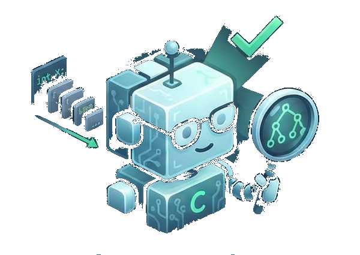

# OptiLexis AI

<p align="center">
  
</p>

<p align="center">
  <strong>A visual compiler and browser-based mini-IDE for learning how source code becomes a program.</strong>
</p>

<p align="center">
  
  
  
  
  
</p>

OptiLexis AI brings the main stages of a compiler into one interactive workspace. Write or load a small C-like program, compile it, inspect how it is tokenized and represented, and explore diagnostics, intermediate code, optimizations, and execution results.

> **Project scope:** OptiLexis AI is an educational mini-compiler for a supported C-like language subset. It is not a standards-complete C compiler and does not produce native machine code.

## Contents

- [What you can do](#what-you-can-do)
- [How a compile works](#how-a-compile-works)
- [Language support and limitations](#language-support-and-limitations)
- [Technology](#technology)
- [Run locally](#run-locally)
- [Optional FastAPI service](#optional-fastapi-service)
- [Deploy the frontend](#deploy-the-frontend)
- [Project structure](#project-structure)
- [Quality checks](#quality-checks)
- [Troubleshooting](#troubleshooting)
- [Contributing](#contributing)

## What you can do

- **Edit in the browser:** Use the Monaco-powered editor, work with multiple file tabs, and format, copy, clear, or reset the active file.
- **Start with a clean workspace:** A new browser tab opens the landing page and then starts with `main.c` containing a small starter program. Workspace files are kept in that tab's session storage, so a refresh preserves edits while a separate tab starts a separate workspace.
- **Explore tokens:** Inspect the token stream, filter by token type, search token values, and jump to the token's source line.
- **Visualize the AST:** Explore a graph of the abstract syntax tree, with controls for navigation and source-line selection.
- **Inspect compiler artifacts:** Review the symbol table, three-address code (TAC), and optimization results.
- **Understand diagnostics:** Find lexical, syntax, and semantic issues by source line.
- **Run supported programs:** Compile and execute supported programs in the browser, view printed output, and inspect a returned value when there is no printed output.
- **Get coding assistance:** Use the explain/optimization assistance surfaces. The optional backend can use Gemini when configured and otherwise provides deterministic fallback responses.
- **Use it on different screens:** The workspace adapts its editor, analysis panels, navigation, and status information for laptop and phone viewports.

### Included sample programs

The sample selector contains examples for:

| Example | What it demonstrates |
| --- | --- |
| Fibonacci Loop | A loop, variables, comparisons, and assignments |
| Function with Parameters | Function declarations, parameters, calls, and returns |
| Bool & If/Else Branches | Boolean values and conditional branches |
| Constant Folding & Dead Code | A sample for inspecting optimization output |
| Syntax Error | A missing-semicolon diagnostic |
| Semantic Error | Undeclared names and incompatible types |
| Lexical Error | An invalid-character diagnostic |

Choosing a sample loads it into the active editor file. It does **not** compile automatically; select **Compile & Run** when you are ready to see results.

## How a compile works

```text
Source code
    │
    ├── Lexical analysis ──> token stream
    ├── Parsing ───────────> abstract syntax tree (AST)
    ├── Semantic analysis ─> symbol information and diagnostics
    ├── TAC generation ────> three-address instructions
    ├── Optimization ──────> optimized TAC and change explanations
    └── Browser execution ─> printed output or return value
```

The interface presents these artifacts in separate panels so you can move between a program and the corresponding compiler representation. The browser execution engine is a small interpreter; it does not invoke a system C compiler.

## Language support and limitations

The project implements a teaching language inspired by C. The exact syntax and execution support are intentionally narrower than full C.

| Area | Supported examples |
| --- | --- |
| Types and values | `int`, `float`, `bool`, `void` function declarations, numeric values, `true`, and `false` |
| Expressions | Arithmetic, comparisons, equality, logical operators, and unary `!` and `-` |
| Statements | Variable declarations, assignments, function calls, `return`, `if`/`else`, and `while` |
| Functions | User-defined functions with typed parameters and return statements |
| Preprocessor | Common `#include` lines are accepted by the compiler pipeline; included libraries are not actually linked |
| Browser output | Basic `printf` string output and common `%d`, `%i`, `%u`, `%f`, `%c`, `%s`, and `%%` format specifiers |

The browser interpreter enforces a 100,000-step execution limit and a maximum function-call depth of 100 to keep execution bounded. It is not a complete implementation of C's standard library or type system. Features such as pointers, structs, arrays, file and operating-system I/O, and native compilation are outside the current interpreter's scope. A program may compile in a compiler stage but still use a feature the browser interpreter cannot execute; runtime failures are reported separately from compile diagnostics.

## Technology

| Layer | Tools |
| --- | --- |
| Frontend | React, TypeScript, Vite |
| Editor | Monaco Editor |
| Styling | Tailwind CSS |
| AST visualization | React Flow and Dagre |
| Backend API | Python, FastAPI, Pydantic, PLY |
| Optional AI provider | Google Gemini via the backend |
| Backend tests | pytest and FastAPI TestClient |

## Run locally

### Prerequisites

- Node.js and npm
- Python 3.10 or newer for the optional backend

### Start the frontend

Run these commands from the repository root:

```powershell
npm install
npm run dev
```

Vite prints the local URL after startup (the project development script uses port `3000`). Open that URL in a browser.

Available frontend scripts:

| Command | Purpose |
| --- | --- |
| `npm run dev` | Start the Vite development server |
| `npm run lint` | Run the TypeScript check (`tsc --noEmit`) |
| `npm run build` | Create the production bundle in `dist/` |
| `npm run preview` | Preview the production bundle locally |

### Start the optional backend

The FastAPI service can be run separately from the frontend. In PowerShell:

```powershell
cd backend
py -m venv .venv
.\.venv\Scripts\Activate.ps1
python -m pip install -r requirements.txt
python -m uvicorn main:app --reload
```

The API listens at `http://127.0.0.1:8000` by default. Visit `http://127.0.0.1:8000/docs` for the interactive OpenAPI documentation.

To enable Gemini-backed assistance, copy `backend/.env.example` to `backend/.env` and set `GEMINI_API_KEY` to a valid key. Do not commit `.env` files or API keys. If no key is configured, the assistance endpoints use deterministic fallback responses.

> The frontend currently defaults to its in-browser compiler/interpreter mode. Running the backend separately does not by itself switch the deployed UI to backend compilation.

## Optional FastAPI service

The API is implemented in `backend/main.py` and exposes:

| Method | Route | Purpose |
| --- | --- | --- |
| `GET` | `/health` | Return service health |
| `POST` | `/compile` | Return tokens, AST, symbols, TAC, optimized TAC, and diagnostics |
| `POST` | `/explain` | Explain a supplied compiler diagnostic and suggest a fix |
| `POST` | `/advise` | Suggest optimizations from source and TAC |

Example compile request:

```http
POST /compile
Content-Type: application/json
```

```json
{
  "code": "int main() { return 42; }"
}
```

The compile response contains `tokens`, `ast`, `symbols`, `tac`, `optimized_tac`, and `errors`. Diagnostics identify their phase (`lexical`, `syntax`, or `semantic`), line number, and message. See `/docs` for the complete request and response schemas.

## Deploy the frontend

The frontend is a Vite static site and can be deployed to Vercel or another static hosting provider:

1. Import the repository into the hosting provider.
2. Set the build command to `npm run build`.
3. Set the output directory to `dist`.
4. Deploy the project.

The static frontend's in-browser mode does not require a backend server. If deploying the optional FastAPI service, host it separately on a Python-capable service and configure the integration before expecting the frontend to use it; the current frontend default is browser mode, as noted above. Never put Gemini credentials in frontend environment variables or browser code.

## Project structure

```text
.
├── backend/
│   ├── main.py              # FastAPI routes and compile pipeline
│   ├── lexer.py             # PLY lexer
│   ├── parser.py            # Grammar and AST construction
│   ├── ast_nodes.py         # AST node definitions
│   ├── semantic.py          # Semantic analysis and symbol table
│   ├── tac.py               # Three-address code generation
│   ├── optimizer.py         # TAC optimization passes
│   ├── ai.py                # Gemini integration and local fallbacks
│   ├── samples/             # Valid and intentionally invalid examples
│   └── tests/               # Backend unit and end-to-end tests
├── public/
│   ├── logo-icon.png
│   └── logo.png
├── src/
│   ├── App.tsx              # Workspace state and application flow
│   ├── api.ts               # Browser compiler and API client
│   ├── runtime.ts           # Browser-side interpreter
│   ├── config.ts            # App defaults and sample programs
│   ├── types/               # Shared TypeScript types
│   └── components/          # Editor, compiler panels, dialogs, and landing page
├── index.html
├── package.json
└── vite.config.ts
```

## Quality checks

Before submitting a change, run the checks from the repository root:

```powershell
npm run lint
npm run build
```

Run the backend test suite from the `backend` directory after activating its virtual environment:

```powershell
python -m pytest -v
```

The backend end-to-end tests exercise the sample programs through compilation and the assistance routes. Unit tests cover the lexer, parser, semantic analysis, TAC generation, and optimizer.

## Troubleshooting

| Symptom | What to check |
| --- | --- |
| Vite cannot start | Confirm Node.js/npm are installed and dependencies are present; run `npm install` from the repository root. |
| Backend command is not found | Activate the backend virtual environment and install `backend/requirements.txt`. |
| Gemini assistance uses a fallback response | Confirm `GEMINI_API_KEY` is set in `backend/.env`, then restart the backend. Fallback responses are expected when no key is configured. |
| A program compiles but execution stops | Check the Output panel's runtime message. Compilation and browser execution are separate stages, and the interpreter supports only the subset described above. |
| Refresh does not show a new workspace | A refresh in the same tab intentionally restores that tab's session. Open a separate tab for a fresh workspace. |

## Contributing

1. Create a focused branch for your change.
2. Keep changes aligned with the supported mini-language and existing frontend/backend responsibilities.
3. Run the TypeScript check, production build, and relevant backend tests.
4. Update this README when setup steps, API behavior, language support, or project structure changes.

---

**OptiLexis AI** — making compiler stages easier to see, inspect, and understand.
